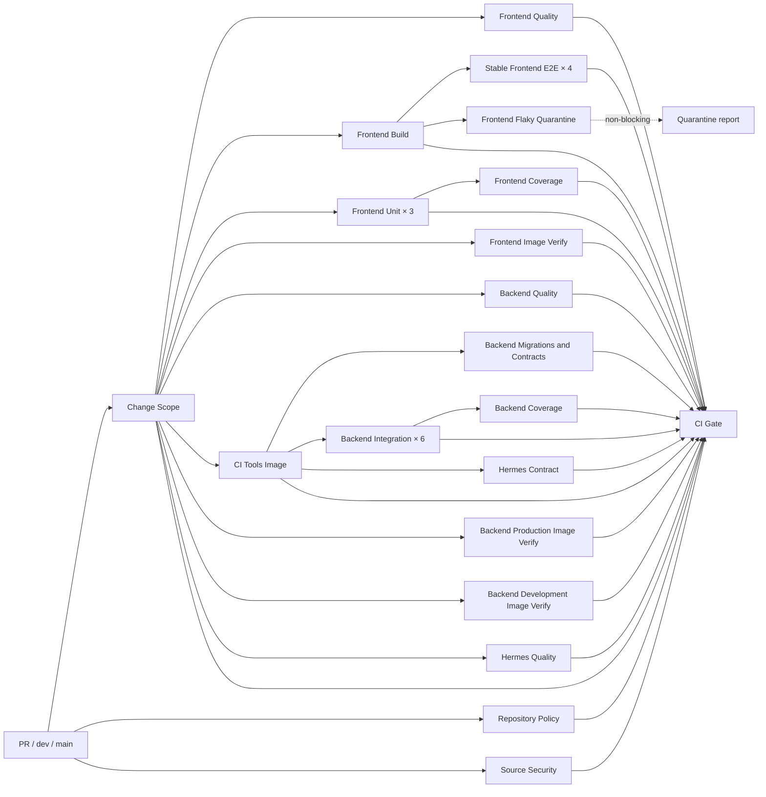

# GitHub CI 与合并门禁

`.github/workflows/ci.yml` 是 GitHub 的单体仓库 CI，在 `dev`、`main` 的
push、pull request 以及手动触发时运行。Workflow 不使用顶层 `paths`
过滤；所有运行都产生稳定的 `CI Gate`。

## Workflow DAG

前端静态检查、生产构建、单测分片和镜像验证按 scope 在 `Change Scope` 成功后
独立启动。稳定 E2E 和 quarantine 只等待 `Frontend Build` 的 bundle，
前端覆盖率检查等待单测分片。后端质量与两种镜像验证按 scope 独立启动；
迁移与契约、集成分片和 Hermes 契约复用本次 CI 的工具镜像，
后端覆盖率检查等待集成分片。
所有适用的阻塞检查都必须成功才能通过 `CI Gate`。
后端交付镜像构建、Trivy 镜像扫描、迁移、容器启动、健康检查和 smoke test
位于同一个 runner，不依赖跨 Job 的本地镜像或服务。

## Change Scope

`Change Scope` 使用完整 Git 历史计算以下输出：

- `frontend_changed`
- `backend_changed`
- `hermes_changed`
- `docker_changed`
- `frontend_image_changed`
- `backend_image_changed`
- `shared_changed`
- `docs_only`

脚本处理 PR base/head、普通 push、merge commit、手动运行、首次 push 和
全零/不可用 before SHA。无法可信解析 base 时按完整 HEAD 文件树执行，
以增加验证代价换取不漏跑门禁。

纯 `docs/` 或 Markdown、MDX、reStructuredText 变更只运行 Change Scope、
Repository Policy、Source Security 和 CI Gate。`.github` Workflow、根配置、`.ci`、
共享脚本与 OpenAPI 契约属于 shared change，会触发全部相关模块。

`Change Scope` 只计算范围。`Repository Policy` 与 `Source Security` 并行启动，
不等待范围计算。`Repository Policy` 运行仓库脚本回归，检查每个 `AGENTS.md` 都有
同目录 `CLAUDE.md` 导入桥接，并按 `.ci/test-impact-policy.toml` 检查生产变更是否
附有对应测试。三项检查均为 CI Gate 必需项。

普通业务源文件修改按所属项目执行构建、测试和覆盖率检查。对应镜像在依赖、
构建或启动配置、脚本、静态资源、后端迁移、运行入口、源文件新增/删除/移动时验证。
纯测试文件变更不触发镜像；shared 或无法识别的根目录变更保守执行两种镜像验证。
手动全量运行也执行镜像检查。CI Gate 使用相同的镜像范围标记判断是否允许跳过。

## 检查内容

### Frontend

`Frontend Quality` 执行 API 生成漂移、页面路由清单、ESLint、TypeScript 和
构建失败边界检查。`Frontend Build` 单独执行 `pnpm build`，上传 production
standalone/static bundle 供 E2E 复用。

`Frontend Unit` 用三个 Vitest 分片执行 `pnpm test:coverage`，每片上传独立 blob。
`Frontend Coverage` 确认三份报告齐全，合并覆盖率数据后执行现有全应用阈值和
80% 变更行阈值。分片失败、取消或报告缺失均阻塞门禁。已生成的 Cobertura 和
覆盖率摘要在阈值检查失败时仍会上传。

`Frontend Image Verify` 独立执行 Compose 校验与前端 Docker build；保留根目录
`Dockerfile`、`frontend` target、`${GITHUB_SHA}` 镜像标签、load 和
`type=gha,scope=frontend` 持久缓存。它与前端质量检查并行，仍是 CI Gate 的
阻塞项；镜像失败不会阻止独立的 E2E 收集结果，也不会被 E2E 成功抵消。

`Stable Frontend E2E` 用四个 Playwright 分片运行同一套
`pnpm test:e2e:critical --grep-invert @flaky`。每片下载本次 CI 的构建产物，
用单 worker 和独立的 standalone server 与 mock API 执行，仍允许一次测试级重试。
分片清单从 Playwright 实时发现的用例生成，按本地测得的耗时估算分配。普通 spec
整文件运行，耗时较长的生产浮层 spec 按相互独立的视口和主题用例分配。
每片通过 JSON 报告核对实际用例 ID，发现遗漏或重复时阻塞门禁。
每片单独上传 HTML 和测试结果，保留失败截图及重试的 trace、视频。

`Frontend Flaky Quarantine` 只运行带 `@flaky` 的测试，Job
`continue-on-error` 且不进入 CI Gate。当前没有隔离测试，因此只写 Step
Summary。新增隔离项必须在测试标题或邻近注释记录 Issue、隔离原因、负责人和
计划修复日期。

### Coverage policy

- 前端覆盖整个 `src`（生成类型除外），当前全量基线为行 4.7%、语句 4.5%、
  函数 4.8%、分支 3.6%。Vitest 阈值使用百分数百分点，不使用 `0.047` 这类
  比例写法；这些数值只允许上调。PR 变更的可执行行覆盖率不得低于 80%。
- 后端覆盖 `app`，行覆盖率不得低于 60%，分支覆盖率不得低于 33.5%，PR
  变更的可执行行覆盖率不得低于 80%。当前后端全量基线余量仍不足以支持稳定
  上调，因此先通过关键业务失败路径和集成契约测试积累余量。
- 低覆盖模块不通过排除生产代码处理。触达模块时由变更行门禁强制补测试，
  全局和分支基线只允许随测试建设逐步上调。

覆盖率报告作为 CI artifact 保留 14 天。提升基线必须在同一 pull request 中提交
具有业务断言的测试，优先覆盖业务规则、权限、确认流程、失败分支和真实
FastAPI 路由。后端下一轮基线提升前，先确保主分支至少连续两次通过，并使
实测值相对目标门槛保留约 5 个百分点余量；前端按单项 1–2 个百分点渐进提升，
避免一次性把全量门槛提高到当前测试资产无法支撑的水平。

### Backend

`Backend Quality` 执行 AgentBackend V2 残留检查、变更 Python 文件 Ruff、
compileall、现有 `mypy app/core` 基线及变更运行文件与依赖链的 Mypy。
unit/core 测试包含在 Integration 全量覆盖率套件中，不重复运行。
CI 将依赖安装与质量检查拆成独立步骤；本地 `ci.sh quality` 仍保留安装后检查的入口。

`Backend Migrations and Contracts` 在空测试库核对唯一 Alembic head，运行
upgrade、模型漂移、FastAPI import 和 OpenAPI 漂移检查。

`Backend Integration` 六片并行运行原全量 Pytest。各片使用独立的 PostgreSQL 17
和 Redis 8，在本片测试库迁移和菜单目录初始化成功后执行测试。同一文件的用例留在同一片并保留
原有收集顺序。分片权重使用成功运行的四份 JUnit 报告，记录累计至少一秒的文件；
其他文件按报告中较短用例的平均耗时估算，每例 0.021 秒。
各片记录 Pytest 启动与收集耗时以及最慢的 15 个测试阶段。
[权重来源 42948663467](https://github.com/Livzon-DS-Sector-AI-Innovation/Livzon-NX/actions/runs/42948663467)

`Backend Coverage` 核对六份清单的全量收集结果一致，并验证所有用例 ID 恰好完成
一次。它合并原始分支覆盖率数据，生成 `coverage.xml`，执行 60% 行、33.5% 分支和
80% 变更行门槛。六片各自上传 JUnit、用例清单和原始覆盖率数据，汇总任务上传
覆盖率报告。迁移与契约、六片测试和覆盖率汇总都成功后，`CI Gate` 才能通过。
本地 `ci.sh integration` 仍提供单进程全量验证入口。

汇总任务通过 `uv sync --frozen --only-group ci-coverage` 安装锁文件中的
Coverage.py、Pytest、greenlet 及其依赖。它读取原始覆盖率和源码生成报告，不加载业务
运行环境。全套业务依赖由六个集成分片安装并执行。全量清单核对、分支数据校验、
60% 行、33.5% 分支和 80% 变更行门槛继续在汇总任务执行。

`Backend Production Image Verify` 和 `Backend Development Image Verify` 各在
自己的 runner 构建一个镜像，使用 `${GITHUB_SHA}` 标记并沿用独立 Buildx/GHA 缓存。
两边都以 app 用户验证 Chromium 渲染和中文 DOCX 转 PDF。交付镜像还生成完整漏洞
报告并阻塞有修复版本的 High/Critical 漏洞，随后使用隔离 Docker network 和临时
PostgreSQL/Redis 验证迁移、容器启动和 `/health`。镜像范围适用时，两个任务都必须通过 CI Gate。

系统依赖下载统一读取 `docker/apt-download.conf`：每个失败请求最多重试 3 次，
HTTP/HTTPS 连接和数据超时均为 30 秒，省略翻译索引；索引刷新失败时返回失败，
不使用旧索引把下载故障当作成功。该配置用于两种后端镜像（含 Playwright
`--with-deps`）及 CI 工具镜像。
不重试测试、迁移或整个镜像构建，不更换软件源、不放宽签名与漏洞门禁。

两种后端镜像均移除基础镜像的 `docker-clean` 钩子，保留下载的 `.deb`，以相同
缓存 ID、`sharing=locked` 挂载 `/var/cache/apt` 和 `/var/lib/apt/lists`。
普通 apt 安装及 Playwright 依赖安装共享这些缓存；索引每次执行安装步骤时仍刷新。
缓存挂载不进入最终镜像。开发后端 uv 缓存挂载到实际的
`/home/app/.cache/uv`，与交付构建共享下载缓存。

后端镜像构建使用与前端一致、固定 SHA 的 `docker/build-push-action`，由 Action
注入 GHA 缓存认证；交付和开发镜像分别读写 `backend`、`backend-dev` scope，
均以 `mode=max` 导出中间层。GHA 导出的是构建层，**不会导出 cache mount 内容**；
apt/uv 挂载在同一持久 builder 内可复用，临时 runner 跨运行主要依靠层缓存。
首次切换到 `backend` scope 需要预热；远程缓存命中及实际 502 改善仍须后续 CI
验证。本地无需访问 GitHub 缓存或真实代理，故障注入命令为：
`python .github/scripts/tests/test_apt_downloads.py AptHTTPTests -v`（Linux，需 apt-get、dpkg-deb）。
用合成包及 loopback 仓库验证连续两次 502 后恢复、热缓存不再下载、重试耗尽失败，
以及已有索引时刷新失败仍阻塞；Windows 会跳过 HTTP 用例，应在隔离 Linux 容器补跑。

### Hermes

`Hermes Quality` 执行残留检查、编译、Dazah 自有兼容边界的 Ruff 和全量
Pytest。固定上游 Hermes 源码不纳入新增的全库 Ruff 门禁，避免用本项目配置
约束禁止本地修改的上游快照。

`Hermes Contract` 使用自己的 PostgreSQL/Redis 环境，运行后端 Agent V2、
Tool Registry、执行入口、权限和参数契约，以及 Hermes
search/describe/execute adapter、OpenAPI 路径、超时和服务不可用契约。

### Security

`Source Security` 始终运行 Trivy filesystem
`vuln,secret,misconfig` 扫描。完整严重度报告非阻塞上传；Secret 或有修复版本
的 High/Critical 漏洞及配置问题阻塞。不维护大范围 ignore，当前也没有
`.trivyignore`。

所有外部 Action 使用完整 commit SHA，Workflow 默认权限只有
`contents: read`。只有 CI Gate 为统计当前运行获得额外的 `actions: read`，
构建和测试 Job 不增加权限。PR 不推送正式镜像。

## 耗时与缓存观测

CI Gate 在执行门禁判定之后，通过 `.github/scripts/ci_metrics.py` 将观测结果
写入 Step Summary，并上传 `ci-metrics-<run_attempt>` JSON artifact，保留 14 天。
两个统计/上传步骤均使用 `always()` 且非阻塞：即使门禁失败也尝试记录，统计
失败不覆盖原门禁结果，也不能让失败的必需检查变绿。

- 耗时从 GitHub Actions 当前 **run ID + attempt** 的 API 读取，支持分页，
  不混用之前重跑的数据。记录各 Job、各步骤的开始到结束耗时与实际结论，
  Summary 展示最长的 15 个已完成步骤，JSON 保留全部步骤。
- `elapsed_to_report_seconds` 是本次 attempt 启动到采集时的时间，包含等待；
  采集时 CI Gate 本身尚未结束，因此不是 workflow 最终耗时。Job 耗时包含
  初始化和清理，并行 Job 耗时不可相加当作墙钟时间。Quarantine 不阻塞 Gate，
  采集时可能尚未完成；中断整个 workflow 时统计也可能来不及执行。
- pnpm 统计使用静态检查、生产构建、覆盖率汇总以及本次 attempt 各单测和 E2E
  分片的 setup-node `cache-hit`。命中表示恢复了锁文件对应的 store 缓存，
  仍需执行依赖安装。命中率以有观测值的任务为分母。
- `queued_seconds` 记录 Actions Job 从 `created_at` 到 `started_at` 的时间，
  用于区分 runner 调度等待与执行耗时。缺失时间戳或跳过的任务标为 `unavailable`。
- Docker 统计来自本次前端、后端交付、后端开发及 CI 工具镜像的 Buildx build ref，通过
  `docker buildx history inspect --format json` 读取
  `NumCachedSteps / NumTotalSteps`。这是 BuildKit 构建步骤复用比例，
  不表示 GHA 缓存下载成功率，也不保存原始构建参数、日志或 provenance。
  Action 的 `builder/node/record` 复合引用需拆为显式 builder 和 record ID，
  不能直接作为 history 的 record 参数。
- 跳过、API 不可访问、构建未完成、Buildx history 不可用或输出缺失时，
  对应观测明确显示 `unavailable`，不伪造为零耗时或缓存 miss。

统计使用 GitHub 临时 token、Action 输出及 CI 进程变量，不引入应用环境配置。
比较优化效果时，按变更范围、attempt 和缓存状态分别比较成功运行，避免将失败
提前结束的耗时或部分 Job 重跑的耗时当作加速结果。第一阶段 PR #182 已核验
E2E 在质量任务结束后 2 秒启动，pnpm 两项均命中、Docker 缓存 4/19，
12 项检查成功；不要求为了证明独立性而人为延迟镜像制造重叠。

本地回归命令：`python -m pytest .github/scripts/tests -q`。测试覆盖独立镜像
依赖、E2E bundle 复用、必需 Job 到 Gate 的完整映射，以及镜像失败/取消/缺失/
意外跳过必须阻塞、统计分页与 attempt 隔离、缓存不可用语义和敏感元数据过滤。

## 第二阶段：依赖与环境稳定性

- 所有 runner 固定为 `ubuntu-24.04`，Node/pnpm 沿用已固定版本，uv 固定为
  与两种 Dockerfile 一致的 `0.13.4`；Python 保持 3.12 系列补丁更新。
  Python 在 setup-uv 前安装，并向 setup-uv 显式传 Python 版本，避免缓存键
  受 runner 预装 Python 影响。更新工具时需同步对应验证，不静默跟随 latest。
- 后端和 Hermes 安装统一经 `.github/scripts/ci_support.py install`，命令仍为
  `uv sync --frozen` 及原有 dev 参数。每个 HTTP 请求最多重试 3 次，连接超时
  10 秒、读取超时 60 秒、并发下载上限 8；单次安装进程总预算 600 秒。
  使用 uv 的请求级重试，不在外层循环重跑整个命令；锁错误、测试、迁移和
  覆盖率失败不会自动重试或被视为成功。安装超时返回 124，启动失败返回 127。
- 保留现有清华 index 和锁内 wheel URL，不增加跨 index 静默回退，也不修改
  依赖版本或 hash。冻结锁文件中的绝对 URL 不会因简单增加另一 index 就可靠
  切换；镜像长期不可用时应独立审查依赖源变更。
- uv 命中状态按后端质量、迁移、覆盖率汇总、各集成分片及 Hermes 任务分别输出
  到 Summary/JSON。命中率以有观测值的任务为分母。后端任务共享后端锁文件键，
  Hermes Quality 使用 Hermes 锁，Hermes Contract 使用两锁组合键。
- `.github/scripts/ci_support.py run` 记录 environment、dependencies、quality、
  migration、contract、tests、coverage 阶段的耗时及退出码。每个 Job 使用
  独立的 RUNNER_TEMP 文件。非矩阵任务通过白名单阶段输出汇总到 Gate，集成分片
  的实际耗时从 Actions 的 Job 和步骤记录读取。阶段类别定位失败发生在
  安装/环境/迁移/测试等哪一步，依赖
  下载的具体网络原因仍从 uv 日志判断，不把所有依赖错误都误报为网络故障。
- 后端集成与契约环境显式提供 PostgreSQL 客户端和 fonts-noto-cjk；在连接
  测试库/跑套件前检查客户端及实际中文字体渲染。稳定 E2E 安装 Chromium 后先
  启动并关闭一个空浏览器，尽早暴露缺二进制/动态库的问题，不改变测试重试策略。
- 仅使用已有 CI 合成测试配置，不读取开发机环境文件。`PYTHONUTF8=1` 只作用于
  CI 进程，文本夹具仍显式声明 UTF-8；候选清理夹具给同龄文件安排至少 1 秒的
  mtime 间隔，避免依赖文件写入速度和枚举顺序。生产清理逻辑不变。

本地故障注入回归使用合成 wheel 和临时 loopback HTTP 服务，验证 503 后恢复、
有限重试耗尽、冷缓存安装、在全新虚拟环境中从热缓存离线安装及锁文件不变。
Repository Policy 固定安装 uv 后运行该回归；不接触公共依赖源、真实凭证或数据库。
环境与编排测试使用命令 fake，断言失败必须向上传播、测试不能进入重试循环。

第二阶段尚未进行线上冷/热缓存全项目安装和连续多轮 CI 采样。上线验收需保留
至少 5 次同范围成功运行的 metrics artifact，按 uv hit/miss、Job、phase 分组
比较安装耗时的中位数及 P95，并单列下载故障、测试失败和取消；失败提前结束、
缓存不可用或不同测试范围不能混入加速结论。已有 React Scheduler 收尾回归可
重复运行，但定向重复通过不等于完整套件已无随机失败。

2026-10-29 本地验证记录：`python -m pytest .github/scripts/tests scripts/tests -q`
为 273 passed、16 skipped、43 subtests passed；16 项为既有平台/工具相关跳过。
固定 uv 0.13.4 的合成 wheel 冷/热缓存和故障注入单测通过；既有 Linux 开发
镜像（uv 0.11.32）以只读源码、`--network none` 独立容器运行同一用例也通过。
React Scheduler 收尾回归连续 5 轮、每轮 3 项通过；中文字体及 Chromium
启动/关闭预检通过，Ruff、actionlint 和 Bash 语法检查通过。这些结果不替代
新 workflow 在 Ubuntu 24.04 上的完整项目门禁与线上缓存统计验收。

## 第三阶段：缩短环境准备与镜像验证

`CI Tools Image` 在后端、Hermes 或 shared 变更时构建
`docker/Dockerfile.ci-tools`，固定 Ubuntu 24.04 和 uv 0.13.4 的基础镜像 digest，
预装 Python 3.12、PostgreSQL 客户端和 CJK 字体。系统包层使用独立的
`type=gha,scope=ci-tools` 缓存，每个 UTC ISO 周刷新。该任务预检系统工具并
保存镜像；后端迁移、六个集成分片及 Hermes 契约下载同一份归档，按构建任务输出的
镜像 ID 校验并运行，不再逐 runner 安装 apt 包。

此试点用本次 Actions 运行的 artifact 分发工具镜像，保留 1 天，不需要写入镜像
仓库或增加 token 权限。本地镜像归档约 162 MiB，上线时需比较上传下载的耗时与
省下的 apt 安装时间。归档过期后需重跑整个 workflow。构建、下载、加载或预检失败
都会阻塞 Gate。工具镜像使用 Linux runner 的网络访问本 Job 独立的数据库和 Redis
端口；不保留 checkout 凭据，仅传入声明的 CI 合成配置和步骤所需变量。
uv 缓存、工作目录和报告留在 runner，
依赖仍按各项目锁文件安装，预检继续实际验证中文渲染。后端质量和覆盖率汇总不依赖
工具镜像。

组织为 GitHub Free，[标准 runner 默认并发上限为 20](https://docs.github.com/en/actions/reference/limits#job-concurrency-limits-for-github-hosted-runners)，
多条 PR 同时运行可能排队。上线后按相同变更范围、冷/热缓存采集至少 20 次首轮
成功运行，比较从触发到 CI Gate 完成的墙钟时间、runner 等待、镜像构建及归档传输
耗时。目标 P50 ≤ 10 分钟、P95 先 ≤ 12 分钟再收紧到 10 分钟；冷缓存首建和
周刷新单列观察，不用本地耗时代替线上验收。

## CI Gate 语义

`CI Gate` 使用 `if: always()`，对每个阻塞 Job 同时检查 scope 预期和
`needs.<job>.result`：

- 模块未变化且 Job 为 `skipped`：允许；
- 模块变化且 Job 为 `success`：允许；
- 模块变化但 Job 为 `skipped`：失败；
- 任意阻塞 Job 为 `failure` 或 `cancelled`：失败；
- Change Scope、Repository Policy 或 Source Security 不是 `success`：失败。

Gate 会将 scope 和“Job、预期、实际结果、结论、原因”表格写入
GitHub Step Summary。Quarantine 不在 Gate 的 `needs` 中。

## GitHub Ruleset / Branch Protection

先让新 Workflow 在一个 PR 上至少成功运行一次，使 GitHub 注册检查名，然后：

1. 打开仓库 **Settings → Rules → Rulesets**（或 Branch protection rules）。
2. 为 `dev` 和 `main` 启用 Require a pull request before merging。
3. 启用 Require status checks to pass，Required check 只选择 `CI Gate`。
4. 启用 Require branches to be up to date before merging。
5. 对 `main` 启用 Block force pushes、Block deletions，并限制直接 push；
   管理员是否允许 bypass 按组织治理要求设置。
6. 新 Gate 稳定后，移除旧的 `Frontend Test`、`Backend Test`、
   `Backend Docker Build`、`Hermes Test` 等 Required Checks。

生产发布由运维手工执行（`scripts/deploy-production.ps1`），CI 不接触生产环境，
也不登记候选、不调度自动发布。2026-10-26 起单机 CD 控制器与自托管 runner 已退役：
`Register CD Candidate` 任务与 `dazah-production-cd-nx` runner 一并移除。
备份、恢复演练与维护闸门仍然保留，操作见
`docs/runbooks/single-host-operations.md`。

## Nightly

本次不创建 nightly Workflow。仓库出现有完整隔离元数据的真实 `@flaky`
测试后，再增加夜间全量 E2E、quarantine、完整安全扫描和长集成测试；nightly
不得成为现有 PR 的 Required Check。
