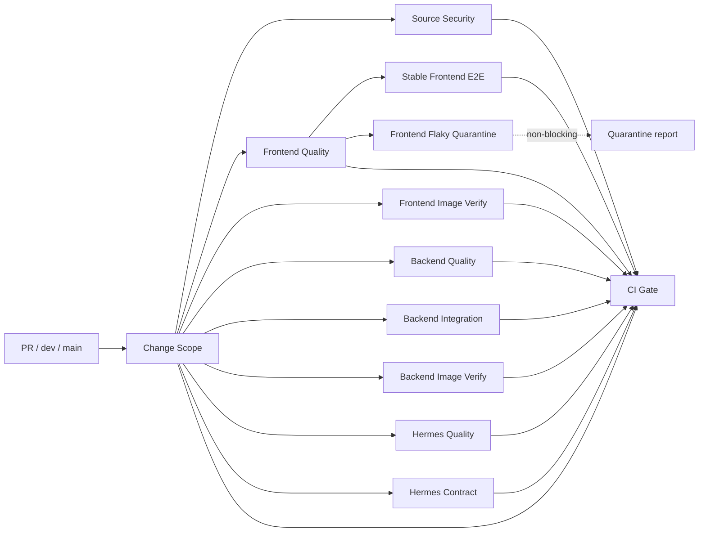

# GitHub CI 与合并门禁

`.github/workflows/ci.yml` 是 GitHub 的单体仓库 CI，在 `dev`、`main` 的
push、pull request 以及手动触发时运行。Workflow 不使用顶层 `paths`
过滤；所有运行都产生稳定的 `CI Gate`。

## Workflow DAG

`Frontend Image Verify`、`Backend Quality`、`Backend Integration`、
`Backend Image Verify` 和 `Hermes Contract` 按 scope 在 `Change Scope` 成功后
独立启动。稳定 E2E 和 quarantine 只等待 `Frontend Quality` 的 bundle，
不等待前端镜像。所有适用的阻塞检查仍必须成功才能通过 `CI Gate`。
后端镜像构建、Trivy 镜像扫描、迁移、容器启动、健康检查和 smoke test
位于同一个 runner，不依赖跨 Job 的本地镜像或服务。

## Change Scope

`Change Scope` 使用完整 Git 历史计算以下输出：

- `frontend_changed`
- `backend_changed`
- `hermes_changed`
- `docker_changed`
- `shared_changed`
- `docs_only`

脚本处理 PR base/head、普通 push、merge commit、手动运行、首次 push 和
全零/不可用 before SHA。无法可信解析 base 时按完整 HEAD 文件树执行，
以增加验证代价换取不漏跑门禁。

纯 `docs/` 或 Markdown、MDX、reStructuredText 变更只运行 Change Scope、
Source Security 和 CI Gate。`.github` Workflow、根配置、`.ci`、
共享脚本与 OpenAPI 契约属于 shared change，会触发全部相关模块。

Change Scope 同时检查每个 `AGENTS.md` 都有同目录 `CLAUDE.md` 导入桥接，并
运行 `.ci/test-impact-policy.toml`；Claude Code 规范入口缺失或生产代码变更
没有对应测试时直接失败。

## 检查内容

### Frontend

`Frontend Quality` 一次安装依赖后执行生成 API 契约漂移、ESLint、
TypeScript、Vitest coverage、80% 变更行覆盖率、Next.js production build、
构建失败边界测试，并上传 production standalone/static bundle 供 E2E 复用。
全量单测、覆盖率和构建命令均保留，覆盖率报告仍在失败时上传。

`Frontend Image Verify` 独立执行 Compose 校验与前端 Docker build；保留根目录
`Dockerfile`、`frontend` target、`${GITHUB_SHA}` 镜像标签、load 和
`type=gha,scope=frontend` 持久缓存。它与前端质量检查并行，仍是 CI Gate 的
阻塞项；镜像失败不会阻止独立的 E2E 收集结果，也不会被 E2E 成功抵消。

`Stable Frontend E2E` 下载本次运行的 production bundle，通过 standalone server 调用
`pnpm test:e2e:critical`，运行身份与模块权限、采购、Livzon Agent 治理台和助手
关键交互测试，且排除 `@flaky`。CI 只允许一次测试级重试；失败时上传 Playwright
HTML、trace、截图和视频。

`Frontend Flaky Quarantine` 只运行带 `@flaky` 的测试，Job
`continue-on-error` 且不进入 CI Gate。当前没有隔离测试，因此只写 Step
Summary。新增隔离项必须在测试标题或邻近注释记录 Issue、隔离原因、负责人和
计划修复日期。

### Coverage policy

- 前端覆盖整个 `src`（生成类型除外），当前全量基线为行 4.7%、语句 4.5%、
  函数 4.8%、分支 3.6%。Vitest 阈值使用百分数百分点，不使用 `0.047` 这类
  比例写法；这些数值只允许上调。PR 变更的可执行行覆盖率不得低于 80%。
- 后端覆盖 `app`，行覆盖率不得低于 60%，分支覆盖率不得低于 33.5%，PR
  变更的可执行行覆盖率不得低于 80%。当前后端全量基线余量仍不足以支持稳定
  上调，因此先通过关键业务失败路径和集成契约测试积累余量。
- 低覆盖模块不通过排除生产代码处理。触达模块时由变更行门禁强制补测试，
  全局和分支基线只允许随测试建设逐步上调。

覆盖率报告作为 CI artifact 保留 14 天。提升基线必须在同一 pull request 中提交
具有业务断言的测试，优先覆盖业务规则、权限、确认流程、失败分支和真实
FastAPI 路由。后端下一轮基线提升前，先确保主分支至少连续两次通过，并使
实测值相对目标门槛保留约 5 个百分点余量；前端按单项 1–2 个百分点渐进提升，
避免一次性把全量门槛提高到当前测试资产无法支撑的水平。

### Backend

`Backend Quality` 执行 AgentBackend V2 残留检查、变更 Python 文件 Ruff、
compileall、现有 `mypy app/core` 基线及变更运行文件与依赖链的 Mypy。
unit/core 测试包含在 Integration 全量覆盖率套件中，不重复运行。

`Backend Integration` 使用独立 PostgreSQL 17 和 Redis 8，检查唯一 Alembic
head、空库 upgrade、model/migration drift、FastAPI import、OpenAPI 漂移，
然后运行全量 Pytest、60% 行覆盖率、33.5% 分支覆盖率和 80% 变更行覆盖率。

`Backend Image Verify` 使用 `${GITHUB_SHA}` 标记镜像并通过 Buildx/GHA cache
构建交付镜像及开发镜像，并验证两者的 app 用户 Chromium 能力。完整漏洞报告作为 artifact；存在有修复版本的 High/Critical
漏洞时阻塞。容器使用隔离 Docker network 和临时 PostgreSQL/Redis。

### Hermes

`Hermes Quality` 执行残留检查、编译、Dazah 自有兼容边界的 Ruff 和全量
Pytest。固定上游 Hermes 源码不纳入新增的全库 Ruff 门禁，避免用本项目配置
约束禁止本地修改的上游快照。

`Hermes Contract` 使用自己的 PostgreSQL/Redis 环境，运行后端 Agent V2、
Tool Registry、执行入口、权限和参数契约，以及 Hermes
search/describe/execute adapter、OpenAPI 路径、超时和服务不可用契约。

### Security

`Source Security` 始终运行 Trivy filesystem
`vuln,secret,misconfig` 扫描。完整严重度报告非阻塞上传；Secret 或有修复版本
的 High/Critical 漏洞及配置问题阻塞。不维护大范围 ignore，当前也没有
`.trivyignore`。

所有外部 Action 使用完整 commit SHA，Workflow 默认权限只有
`contents: read`。只有 CI Gate 为统计当前运行获得额外的 `actions: read`，
构建和测试 Job 不增加权限。PR 不推送正式镜像。

## 耗时与缓存观测

CI Gate 在执行门禁判定之后，通过 `.github/scripts/ci_metrics.py` 将观测结果
写入 Step Summary，并上传 `ci-metrics-<run_attempt>` JSON artifact，保留 14 天。
两个统计/上传步骤均使用 `always()` 且非阻塞：即使门禁失败也尝试记录，统计
失败不覆盖原门禁结果，也不能让失败的必需检查变绿。

- 耗时从 GitHub Actions 当前 **run ID + attempt** 的 API 读取，支持分页，
  不混用之前重跑的数据。记录各 Job、各步骤的开始到结束耗时与实际结论，
  Summary 展示最长的 15 个已完成步骤，JSON 保留全部步骤。
- `elapsed_to_report_seconds` 是本次 attempt 启动到采集时的时间，包含等待；
  采集时 CI Gate 本身尚未结束，因此不是 workflow 最终耗时。Job 耗时包含
  初始化和清理，并行 Job 耗时不可相加当作墙钟时间。Quarantine 不阻塞 Gate，
  采集时可能尚未完成；中断整个 workflow 时统计也可能来不及执行。
- pnpm 统计来自 Frontend Quality 和 Stable Frontend E2E 的 setup-node
  `cache-hit` 输出，表示锁文件对应的 store 缓存恢复；不代表 node_modules
  可以跳过安装。单次报告的命中率仅以这两个 Job 中有观测值的项为分母。
- Docker 统计来自本次前端镜像的 Buildx build ref，通过
  `docker buildx history inspect --format json` 读取
  `NumCachedSteps / NumTotalSteps`。这是 BuildKit 构建步骤复用比例，
  不表示 GHA 缓存下载成功率，也不保存原始构建参数、日志或 provenance。
- 跳过、API 不可访问、构建未完成、Buildx history 不可用或输出缺失时，
  对应观测明确显示 `unavailable`，不伪造为零耗时或缓存 miss。

统计使用 GitHub 临时 token、Action 输出及 CI 进程变量，不引入应用环境配置。
比较优化效果时，按变更范围、attempt 和缓存状态分别比较成功运行，避免将失败
提前结束的耗时或部分 Job 重跑的耗时当作加速结果。尚无本次新 DAG 的线上测量
结果；首轮 PR CI 需要验证 E2E 在镜像未结束时可启动、缓存计数及 artifact 均正常。

本地回归命令：`python -m pytest .github/scripts/tests -q`。测试覆盖独立镜像
依赖、E2E bundle 复用、必需 Job 到 Gate 的完整映射，以及镜像失败/取消/缺失/
意外跳过必须阻塞、统计分页与 attempt 隔离、缓存不可用语义和敏感元数据过滤。

## CI Gate 语义

`CI Gate` 使用 `if: always()`，对每个阻塞 Job 同时检查 scope 预期和
`needs.<job>.result`：

- 模块未变化且 Job 为 `skipped`：允许；
- 模块变化且 Job 为 `success`：允许；
- 模块变化但 Job 为 `skipped`：失败；
- 任意阻塞 Job 为 `failure` 或 `cancelled`：失败；
- Change Scope 或 Source Security 不是 `success`：失败。

Gate 会将 scope 和“Job、预期、实际结果、结论、原因”表格写入
GitHub Step Summary。Quarantine 不在 Gate 的 `needs` 中。

## GitHub Ruleset / Branch Protection

先让新 Workflow 在一个 PR 上至少成功运行一次，使 GitHub 注册检查名，然后：

1. 打开仓库 **Settings → Rules → Rulesets**（或 Branch protection rules）。
2. 为 `dev` 和 `main` 启用 Require a pull request before merging。
3. 启用 Require status checks to pass，Required check 只选择 `CI Gate`。
4. 启用 Require branches to be up to date before merging。
5. 对 `main` 启用 Block force pushes、Block deletions，并限制直接 push；
   管理员是否允许 bypass 按组织治理要求设置。
6. 新 Gate 稳定后，移除旧的 `Frontend Test`、`Backend Test`、
   `Backend Docker Build`、`Hermes Test` 等 Required Checks。

生产发布由运维手工执行（`scripts/deploy-production.ps1`），CI 不接触生产环境，
也不登记候选、不调度自动发布。2026-10-26 起单机 CD 控制器与自托管 runner 已退役：
`Register CD Candidate` 任务与 `dazah-production-cd-nx` runner 一并移除。
备份、恢复演练与维护闸门仍然保留，操作见
`docs/runbooks/single-host-operations.md`。

## Nightly

本次不创建 nightly Workflow。仓库出现有完整隔离元数据的真实 `@flaky`
测试后，再增加夜间全量 E2E、quarantine、完整安全扫描和长集成测试；nightly
不得成为现有 PR 的 Required Check。
